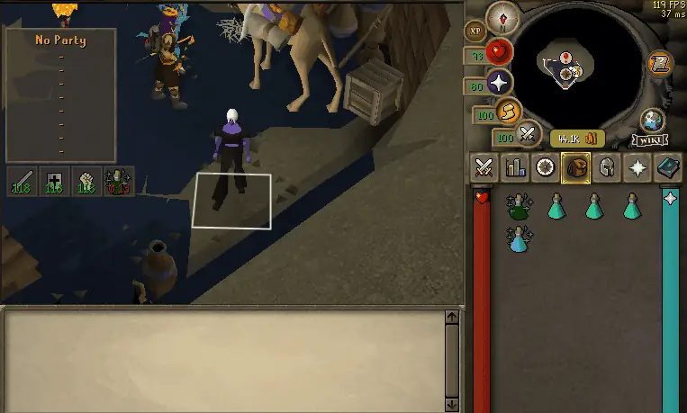

# Pot Alert

When a pot is about to run out, your screen edges glow in that pot's color and it plays a sound, so you know what to drink without looking at your stats.

### How it works

- It warns you once and then goes quiet. The glow fades after a few seconds or as soon as you sip.
- Once you drink and you're back up, it's ready to warn you again next time.
- It only cares about pots you actually have in your inventory, and boosts you've actually drunk.
- The pot you need also gets outlined in your inventory.

### What it covers

- Combat boosts: attack, strength, defence, super combat, ranging, bastion, magic, battlemage, zamorak brew and armadyl brew, including divines, mixes and raid versions. Warns at your Resip at level.
- Skilling boosts: fishing, hunter and agility. Warns at your Resip at level.
- Timed pots: divines, overload, smelling salts, anti-venom, antifire, prayer regen, prayer enhance, liquid adrenaline, menaphite remedy, stamina and goading. Warns before they run out.
- Prayer: prayer pots, super restores, sanfew, revitalisation, tears of elidinis and blessed crystal scarabs. Warns at your Alert at prayer.
- Absorption: warns at your Alert at absorption. It only starts watching once you've drunk above that, so starting a dream won't set it off.
- Imbued and saturated heart: warns when it's ready and your magic is low.

Anti-venom and antifire also warn once when they actually run out, even if you're out of pots, so you know to tele.

### Settings worth knowing

- Remind again every: turn this on if you want repeat warnings. 0 means one warning only.
- Match my weapon (off by default): combat boosts only warn for the style you're using. The rest wait until you swap.
- Brighten dark potions (on by default): makes dark pots like anti-venom and overload easier to see.
- Highlight pot in inventory (on by default): outlines the pot you need. Outline thickness goes from 1 (thin) to 3 (extra bold).
- Only in combat: only warns while you're fighting. Skilling pots still warn.
- Every pot has its own sound, like a snake hiss for anti-venom and dragon breath for antifire. You can pick a different one, use your own .wav, or turn it off for glow only. Volume 0 mutes everything.
- The glow uses the pot's actual color, or you can pick your own.

There's also a Pot Alert tab in the sidebar where you can test any pot's warning and add your own sounds.

Found a bug or have an idea? Hit Report an issue at the top of this page.
